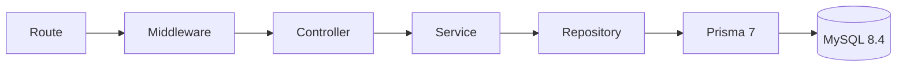

# API Bancária Simulada — P2

API acadêmica para apoiar o atendimento presencial de clientes que precisam de ajuda para usar serviços bancários. Um operador autenticado atende o cliente depois que ele confirma a senha de atendimento. As operações ficam registradas para auditoria e usam lançamentos contábeis equilibrados.

**Pix, TED, depósitos e saques são simulações internas.** O projeto não se conecta ao Banco Central, a bancos, ao SPI ou ao STR e não movimenta dinheiro real.

## O que o projeto entrega

- 27 rotas funcionais e 3 rotas auxiliares, documentadas em OpenAPI.
- CRUDs completos de Clientes, Chaves Pix e Favorecidos.
- Login de administrador master com JWT e senha com hash Argon2id.
- Atendimentos autorizados pela senha do cliente, com expiração e bloqueio após tentativas erradas.
- Contas correntes e poupança, depósitos, saques e transferências PIX, TED e internas.
- Ledger de partidas dobradas, idempotência, proteção contra saldo negativo e conciliação.
- Swagger UI em `/docs` e especificação em `/openapi.json`.

## Contexto e regra de negócio

Na agência, um funcionário pode ajudar uma pessoa idosa ou com pouca familiaridade digital a realizar uma operação. O operador entra com sua conta master; o cliente confirma a própria senha para abrir um atendimento. O atendimento limita os dados disponíveis ao cliente autorizado. Cada movimentação registra o operador e o atendimento, e uma transação só é concluída quando todos os saldos, lançamentos e dados de auditoria são gravados juntos.

## Arquitetura



As regras de negócio ficam nos Services. Regras específicas de PIX, TED e transferência interna usam três Strategies. Veja [docs/ARCHITECTURE.md](docs/ARCHITECTURE.md) para responsabilidades, convenções e justificativas das tecnologias.

## Pré-requisitos

- Node.js 24.x e npm.
- Docker Desktop com Docker Compose, ou MySQL 8.4/InnoDB acessível localmente.
- No exemplo local, a porta `3307` do host encaminha para a porta `3306` do container. Esse valor evita conflito com instalações locais que já usam `3306`.

## Instalação e execução

Na raiz do projeto:

```bash
cp .env.example .env
```

Revise o `.env` e substitua os valores de desenvolvimento por valores próprios. Configure `ADMIN_NAME`, `ADMIN_EMAIL` e `ADMIN_PASSWORD`; use uma `JWT_SECRET` aleatória com pelo menos 32 caracteres. Não versione o `.env`.

Suba o banco local e instale as dependências. O Compose usa o projeto e o volume `api-banco-p2-isolated`, com a porta do host `3307`; assim, os comandos deste repositório não substituem outros containers do projeto `apibanco` nem o MySQL local em `3306`.

```bash
docker compose up -d mysql
npm ci
```

Gere o Prisma Client, aplique as migrations e crie a conta SYSTEM e o administrador master:

```bash
npm run db:generate
npm run db:migrate
npm run db:seed
```

Inicie a API:

```bash
npm run dev
```

- API: `http://localhost:3000`
- Saúde e conexão com o banco: `http://localhost:3000/health`
- Swagger UI: `http://localhost:3000/docs`
- OpenAPI JSON: `http://localhost:3000/openapi.json`

Para executar a versão compilada:

```bash
npm run build
npm start
```

O seed cria a conta de compensação SYSTEM de forma idempotente. Ele cria ou atualiza o admin com as variáveis `ADMIN_*`; não cadastra clientes de demonstração nem dados pessoais.

## Autenticação e primeiro atendimento

No Swagger, execute `POST /api/v1/auth/login` com as credenciais definidas no `.env`:

```json
{
  "email": "admin@example.test",
  "password": "troque-esta-senha-local"
}
```

Use o `accessToken` recebido no botão **Authorize** (`bearerAuth`). Para iniciar um atendimento, execute `POST /api/v1/service-sessions` com o CPF e a senha fictícia de um cliente já cadastrado. A resposta contém o identificador `id` do atendimento. Nas operações em nome dele, informe esse valor em `X-Service-Session-Id` no **Authorize** (`serviceSession`).

O cadastro do cliente (`POST /api/v1/customers`) já abre a primeira conta (corrente por padrão) e devolve a agência e o número. Clientes são consultados, alterados e excluídos pelo **CPF** (`/api/v1/customers/{cpf}`). Contas são identificadas pelo **número da conta** (7 dígitos, agência `0001`), devolvido na abertura e na listagem `GET /api/v1/customer-service/accounts`; use esse número em depósitos, saques, transferências, extrato e bloqueio.

O fluxo de transferência também exige um UUID novo em `Idempotency-Key`. Repetir a mesma requisição com a mesma chave devolve a resposta gravada com HTTP 200; reutilizar a chave com outro payload retorna 409.

## Testes e comandos

```bash
npm run typecheck
npm run lint
npm run test:unit
npm run test:e2e
npm test
```

Os testes unitários não precisam de banco. Os testes E2E aplicam migrations e limpam **somente** as tabelas da database indicada por `TEST_DATABASE_URL`, que deve apontar para `bank_api_test`. Nunca aponte essa variável para dados de desenvolvimento ou produção.

Outros comandos disponíveis:

| Comando                   | Uso                                            |
| ------------------------- | ---------------------------------------------- |
| `npm run db:generate`     | Gerar o Prisma Client                          |
| `npm run db:migrate`      | Aplicar migrations ao banco de desenvolvimento |
| `npm run db:test:prepare` | Aplicar migrations ao banco E2E                |
| `npm run db:seed`         | Criar ou atualizar SYSTEM e admin              |
| `npm run db:studio`       | Abrir o Prisma Studio                          |
| `npm run format`          | Formatar os arquivos com Prettier              |

## Regras resumidas

- Valores entram e saem como centavos inteiros em string; o processamento usa `bigint`, nunca ponto flutuante.
- INTERNAL só aceita outra conta do mesmo cliente. PIX usa uma chave cadastrada e aplica limite noturno por transferência. TED usa uma tarifa fixa e, quando habilitado, funciona em dias úteis e horário configurado.
- A tarifa de TED é debitada da origem e creditada na SYSTEM. Toda operação financeira grava débitos e créditos no ledger dentro da mesma transação de banco.
- A SYSTEM pode ficar negativa; contas de clientes não. O saldo de cliente é debitado com atualização condicional no banco.
- O ledger pode ser conferido em `GET /api/v1/ledger/reconciliation`.

Veja [docs/BUSINESS_RULES.md](docs/BUSINESS_RULES.md), [docs/API_FLOWS.md](docs/API_FLOWS.md), [docs/DEMO_CHECKLIST.md](docs/DEMO_CHECKLIST.md), [docs/REQUIREMENTS_P2.md](docs/REQUIREMENTS_P2.md) e [docs/PRESENTATION_40_50_MIN.md](docs/PRESENTATION_40_50_MIN.md).

## Entrega acadêmica

O grupo deve revisar e preparar os slides finais, criar ou publicar o repositório público no GitHub e enviar o link e os slides pelo Google Classroom no prazo informado pelo professor. O prazo não foi registrado no material disponível. O projeto não publica arquivos nem define a visibilidade do repositório.

Antes de publicar, removam dados de teste locais, usem apenas credenciais fictícias e confirmem que `.env`, tokens, banco local e arquivos gerados não entraram no Git.
