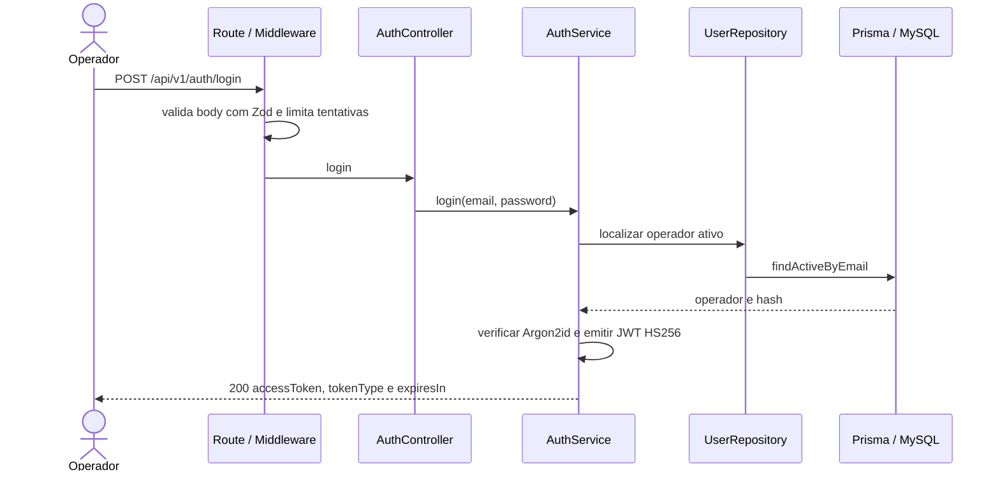
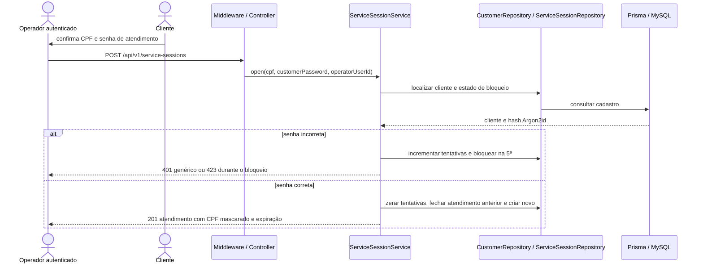
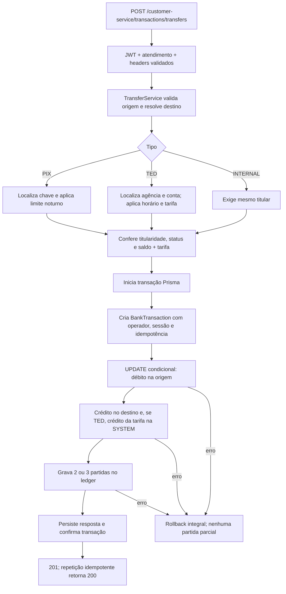

# Fluxos da API

## Login do operador master

Credenciais incorretas respondem 401 com mensagem genérica. O JWT fixa algoritmo, emissor, audiência e validade de 60 minutos.

## Abertura do atendimento

O middleware de atendimento exige `X-Service-Session-Id`, verifica operador, status e expiração e coloca o cliente autorizado no contexto da requisição. Sem o header, responde 401; sessão fechada, expirada ou de outro operador responde 403.

## Transferência PIX, TED ou interna

As três regras estão em `src/services/transfer-rules/`. O fluxo real percorre `src/routes/customer-service.routes.ts` → `src/controllers/TransactionController.ts` → `src/services/TransferService.ts` → regra Strategy e repositories → Prisma. A atualização condicional é o controle de concorrência que impede saldo negativo.
