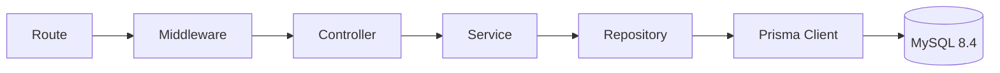

# Arquitetura e decisões técnicas

## Camadas

- **Route:** associa método e caminho aos middlewares e ao controller.
- **Middleware:** autentica o JWT, valida o atendimento, valida entradas Zod, limita requisições e formata erros.
- **Controller:** lê a requisição, chama o service e converte o resultado em HTTP; não consulta Prisma.
- **Service:** implementa regras de negócio, cálculos, autorização por cliente, transações e erros de aplicação; não conhece `Request` nem `Response` do Express.
- **Repository:** executa operações Prisma sem decidir regras de negócio ou status HTTP.
- **Utils:** funções reutilizáveis para dinheiro, CPF, horário, máscara, hash, JWT e idempotência.

O `src/container.ts` instancia repositories, services e controllers. A composição fica explícita e a interface HTTP permanece separada das regras de negócio. Rotas não calculam valores nem acessam o banco; controllers não implementam regras; services não montam respostas Express; repositories não decidem permissões ou regras de transferência.

## Padrões

- **Arquitetura em camadas** para separar transporte, negócio e persistência.
- **Repository** para concentrar acesso Prisma por módulo.
- **Service Layer** para manter regras fora dos controllers.
- **Strategy** para regras específicas de PIX, TED e transferência interna.
- **Middleware / chain of responsibility** para autenticação, atendimento, validação e erros.
- **Validação por schema** com Zod 4 para entradas e geração OpenAPI.

## Persistência e consistência financeira

- Prisma 7 gera um cliente tipado para `src/generated/prisma/`; o diretório é regenerado e não é versionado. O schema e as migrations ficam em `prisma/`.
- MySQL 8.4/InnoDB é o banco previsto para execução. O adapter `@prisma/adapter-mariadb` conecta o Prisma Client; a CLI usa `DATABASE_URL` e uma database de shadow separada.
- O banco E2E fica em `TEST_DATABASE_URL` (`bank_api_test`). A configuração `prisma.test.config.ts` limita migrations ao destino de teste; o setup limpa apenas tabelas desse banco.
- Valores são `BIGINT` em centavos. Débitos de cliente usam `UPDATE` condicional (`ACTIVE` e saldo maior ou igual ao débito); o update, os créditos, a transação e as partidas de ledger são confirmados ou revertidos juntos.
- A conta SYSTEM pode ficar negativa. Constraints de banco impedem saldo negativo de cliente e valores financeiros inválidos. A rota de conciliação compara partidas e saldos materializados.
- A chave idempotente e o fingerprint são gravados na mesma transação que movimenta saldos. Reenvio igual retorna a resposta persistida; reuso conflitante retorna 409.

## Justificativa das tecnologias

- **Express 5:** roteamento HTTP simples, ecossistema consolidado e encaminhamento nativo de erros de handlers assíncronos.
- **Zod 4:** valida em runtime e infere os tipos TypeScript dos schemas.
- **Argon2id:** deriva hashes de senha apropriados para armazenamento de credenciais.
- **jose/JWT:** emite e verifica access tokens com algoritmo, emissor, audiência e expiração fixados.
- **Vitest e Supertest:** executam testes unitários rápidos e testes das rotas HTTP sem abrir porta pública.
- **Helmet:** configura cabeçalhos HTTP defensivos.
- **express-rate-limit:** limita tentativas em login, atendimento e movimentações.
- **Docker Compose:** reproduz MySQL 8.4 e mantém banco de teste isolado do banco de desenvolvimento.
- **Prisma 7:** modela o schema, gera cliente tipado e versiona migrations para MySQL.

## Convenções

Identificadores de funções, variáveis, propriedades e métodos usam camelCase; classes e tipos usam PascalCase; enums usam membros UPPER_CASE. A ESLint verifica nomenclatura. Toda classe e função nomeada tem comentário curto em português do Brasil, no infinitivo, acima da declaração.

Dinheiro é armazenado em `BIGINT` como centavos e serializado como string. CPF, números de conta e nomes de contraparte são mascarados onde a regra pede; hashes de senha nunca saem nos presenters. HTTPS é necessário quando a API for exposta fora da máquina local.

## Referências oficiais

- [Prisma ORM 7: gerar Prisma Client](https://www.prisma.io/docs/orm/v7/prisma-client/setup-and-configuration/generating-prisma-client)
- [Prisma adapter MariaDB](https://www.npmjs.com/package/@prisma/adapter-mariadb)
- [Prisma Migrate: shadow database](https://www.prisma.io/docs/orm/v7/prisma-migrate/understanding-prisma-migrate/shadow-database)
